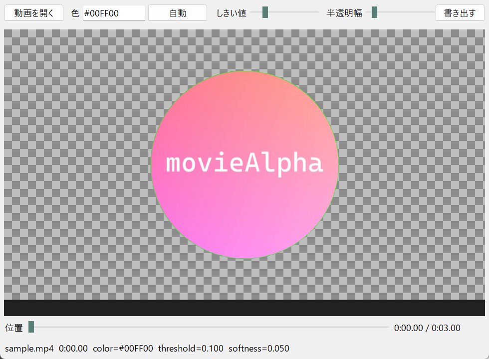

# movieAlpha

MP4 の指定色をアルファチャンネルに置き換える簡易ツールです。OBS のメディアソース向けに、透過付き WebM（VP9）を書き出します。



## 主な機能

- 指定色（またはクリックで拾った色・四隅から自動判定した色）を透明にした動画を書き出し
- しきい値と半透明幅で、境界のなじみ具合を調整（OBS の Color Key と同じ考え方）
- GUI ではフレームをシークしながら、透過結果を市松模様のプレビューで確認
- 出力は透過付き WebM（VP9）または MOV、プレビュー PNG だけの書き出しも可
- RGB の `colorkey`（単色背景向け）と YUV の `chromakey`（実写グリーンバック向け）を切り替え

処理の実体は [FFmpeg `colorkey`](https://ffmpeg.org/ffmpeg-filters.html#colorkey) です。フィルタグラフの組み立ては [ffmpeg-python](https://github.com/kkroening/ffmpeg-python) に合わせています。

## ダウンロード（Windows）

[Releases](https://github.com/tomozow/movieAlpha/releases) から zip をダウンロードして展開します。

- `moviealpha-gui.exe` — ダブルクリックで画面が開きます（動画ファイルを exe にドロップしても開けます）
- `moviealpha.exe` — コマンドライン版（下の「使い方」の `moviealpha` と同じ）

どちらも [FFmpeg](https://ffmpeg.org/download.html) が PATH にある必要があります。

## 必要環境（ソースから使う場合）

- Python 3.10+
- [FFmpeg](https://ffmpeg.org/download.html)（`ffmpeg` / `ffprobe` が PATH にあること）

## インストール

```powershell
git clone https://github.com/tomozow/movieAlpha.git
cd movieAlpha
python -m venv .venv
.\.venv\Scripts\Activate.ps1
pip install -e .
```

## 使い方

黒背景を透明にする（OBS オーバーレイ向けの例）:

```powershell
moviealpha "overlay.mp4" --color "#000000" --threshold 0.08 --softness 0.12
```

四隅の最多色を自動でキーにする:

```powershell
moviealpha input.mp4 --color auto
```

画面で色を拾う（`gui.bat` をダブルクリックでも起動します）:

```powershell
moviealpha input.mp4 --gui
```

プレビュー PNG だけ出す:

```powershell
moviealpha input.mp4 --color #00FF00 --preview preview.png
```

## 主なオプション

| オプション | 説明 |
|---|---|
| `--color` | `#RRGGBB` / `0xRRGGBB` / `auto` |
| `--threshold` | 完全に透明にする色距離のしきい値（別名 `--similarity`） |
| `--softness` | しきい値の外側を半透明にする幅（別名 `--smoothness` / `--blend`） |
| `--method` | `colorkey`（RGB・既定） / `chromakey`（YUV） |
| `--format` | `webm` / `mov` |
| `--no-audio` | 音声を落とす |
| `--gui` | クリックで色指定 |

通常の MP4（H.264）は透過を保存できないため、出力は WebM または MOV です。OBS ではメディアソースに WebM を読み込みます。

PowerShell では `#000000` がコメントになるため、色は `"#000000"` のように引用符で囲んでください。
